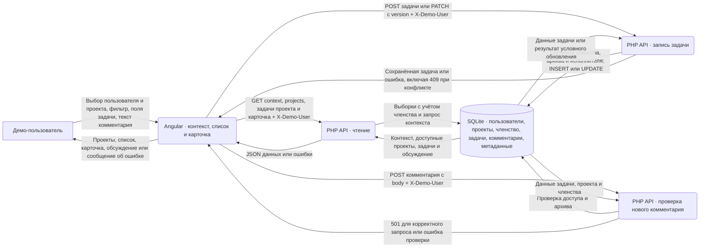

# Диаграмма потоков данных

1. При старте интерфейс запрашивает контекст и проекты, затем загружает задачи выбранного проекта. API возвращает списки проектов и задач; поиск по названию и фильтр статуса применяются в браузере к загруженному списку.
2. При открытии карточки API читает задачу и комментарии с именами авторов в порядке их ID. Запись задачи возвращает её актуальные поля, включая версию. При конфликте PATCH интерфейс показывает ошибку с предложением открыть задачу заново.
3. При отправке комментария API проверяет членство, архив и текст. Корректный запрос завершается 501, поэтому поток записи в таблицу `comments` отсутствует.
4. При первом обращении к API инициализация создаёт схему и демонстрационные записи. Повторные запросы используют существующие данные.

Источники: [клиент API](https://github.com/SherpaRPA/SherpaHR/blob/d85eb5e76bd0c839798ec55d21c7f0745b6f995f/frontend/src/api.ts), [компонент Angular](../../../frontend/src/app.ts), [маршруты API](https://github.com/SherpaRPA/SherpaHR/blob/d85eb5e76bd0c839798ec55d21c7f0745b6f995f/backend/src/Application.php), [инициализация БД](../../../backend/src/Database.php).
