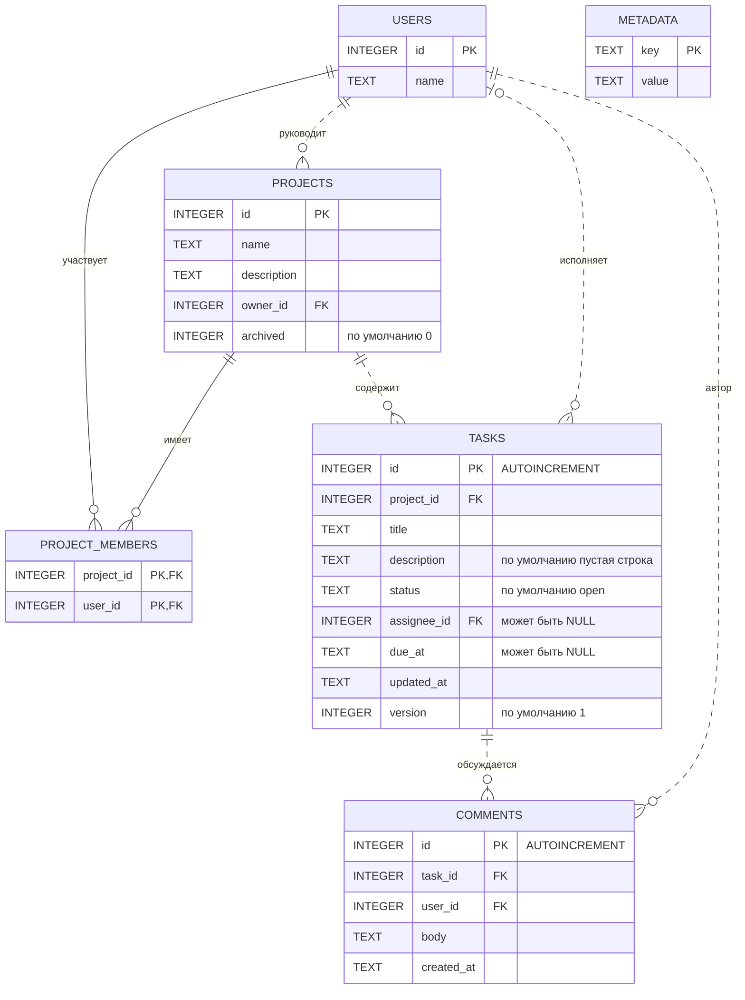

# ER-диаграмма SQLite

- Пара `(project_id, user_id)` уникальна. Членство определяет доступ к проекту. Руководитель хранится отдельно в `owner_id` и получает доступ по тому же правилу членства.
- У задачи один проект и ноль или один исполнитель. SQLite проверяет ссылку на пользователя, API дополнительно требует членство исполнителя именно в проекте задачи.
- У комментария одна задача и один автор. Чтение обсуждения проверяет членство через проект задачи. В текущем демо комментарии записывает инициализация данных.
- SQLite ограничивает статус значениями `open`, `in_progress`, `blocked`, `done`. API разрешает сохранять любое из этих значений без отдельной проверки переходов. `version` используется для защиты от устаревшей записи при PATCH.
- `metadata` создаётся при инициализации и хранит `schema_version` и `seeded_at`. Сроки и метки времени передаются в UTC. Индексы `tasks_project` и `comments_task` поддерживают выборки задач проекта и обсуждения задачи.

Источники: [backend/schema.sql](../../../backend/schema.sql), [Database.php](../../../backend/src/Database.php), [Application.php](https://github.com/SherpaRPA/SherpaHR/blob/d85eb5e76bd0c839798ec55d21c7f0745b6f995f/backend/src/Application.php).
