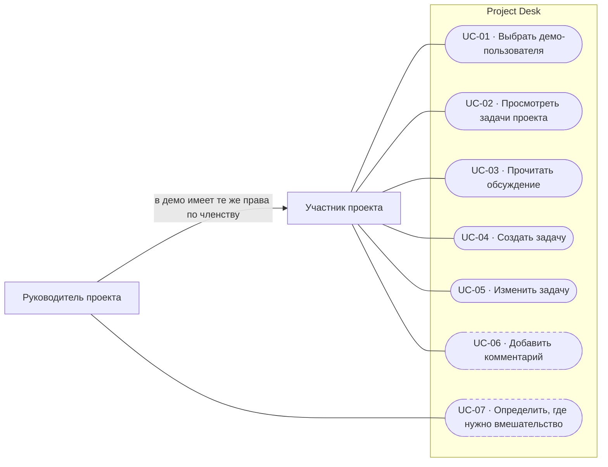

# Use Case

Пунктир обозначает сценарии, которые пока нельзя завершить. Анна, Борис и Вера действуют как участники в пределах доступных им проектов. Роль руководителя важна для целевого обзора, а существующие операции чтения и записи проверяют членство.

| ID | Актор и условия | Основной поток и результат | Альтернативный поток |
|---|---|---|---|
| UC-01 | Демо-пользователь открыл приложение | Выбирает Анну, Бориса или Веру. Интерфейс закрывает карточку, обновляет контекст и загружает доступные проекты | API возвращает 401 для неизвестного демо-пользователя |
| UC-02 | Участник, проект доступен | Выбирает проект, просматривает таблицу и при необходимости фильтрует по названию и статусу | Недоступный проект даёт 404. Задача без исполнителя отсутствует в списке после загрузки, см. [расхождения](../inconsistencies.md) |
| UC-03 | Участник, задача принадлежит доступному проекту | Открывает карточку и читает поля задачи и комментарии с авторами и временем UTC | При пустой истории интерфейс сообщает об отсутствии комментариев. Архив сохраняет чтение, недоступная задача даёт 404 |
| UC-04 | Участник активного проекта | Открывает форму новой задачи, вводит название, при необходимости заполняет остальные поля и сохраняет. API возвращает созданную задачу и 201 | Недопустимые поля или исполнитель вне проекта дают 422, запись в архив — 409. Задача без исполнителя исчезает из списка после повторной загрузки |
| UC-05 | Участник активного проекта, карточка загружена | Изменяет поля и сохраняет. API принимает актуальную версию, увеличивает её и возвращает сохранённые поля | При устаревшей версии API возвращает 409. Для повторной попытки нужно заново открыть задачу |
| UC-06 | Участник активного проекта, карточка открыта | Целевой поток: вводит текст и отправляет. Комментарий появляется в обсуждении с автором, сохраняется и виден при повторном открытии | Сейчас корректный запрос даёт 501. Некорректный текст даёт 422, архив — 409, чужая задача — 404 |
| UC-07 | Анна координирует несколько активных проектов | Целевой поток: открывает общий обзор, видит задачи, требующие внимания, и причину отбора, переходит в полную карточку. При необходимости читает обсуждение, отвечает или меняет задачу | Сейчас Анна обходит проекты вручную. [Предлагаемые критерии](../user-stories/README.md) описывают состав обзора и пустой результат |

Источники: [контекст продукта](../../product.md), [задание v7](../../../task_v7.md), [API](../../api.md).
