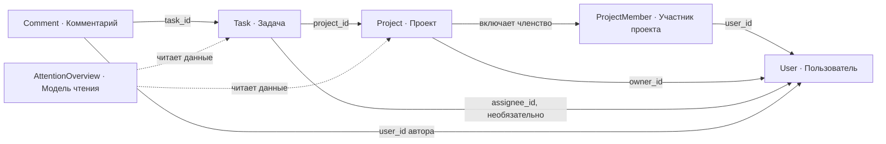

# Доменная модель Project Desk

Модель описывает текущие данные и целевые границы операций v7. Термины согласованы с [единым языком проекта](../../architecture/domain-and-contracts.md). Структура хранения описана в [ER-диаграмме](../../analyze/diagrams/er.md).

| Документ | Содержание |
|---|---|
| [Сущности](entities.md) | Идентичность, атрибуты, связи и жизненный цикл |
| [Объекты-значения](value-objects.md) | Правила допустимости, равенство, отображение в HTTP и SQLite |
| [Агрегаты](aggregates.md) | Корни, границы записи, инварианты и модель чтения обзора |

Модель задаёт смысл и правила данных. При реализации простые значения можно оставить скалярами, enum или типизированными формами массивов. Отдельный PHP-класс оправдан, если он централизует повторяющуюся проверку или операцию.

## Структура PHP-кода

Код в `backend/src/Domain/` сгруппирован по предметным областям. В каждой папке рядом находятся сущности, корни агрегатов и используемые ими объекты-значения.

| Папка | Содержимое |
|---|---|
| [`Task/`](../../../backend/src/Domain/Task) | Задача, отдельный агрегат комментария, статусы, причины внимания, идентификаторы и значения задачи и обсуждения |
| [`User/`](../../../backend/src/Domain/User) | Пользователь и его идентификатор |
| [`Project/`](../../../backend/src/Domain/Project) | Проект, членство и идентификатор проекта |
| [`Exception/`](../../../backend/src/Domain/Exception) | Общее доменное исключение |

Имена папок задают группировку внутри Project Desk. Состав bounded contexts обсуждается отдельно по [плану реализации](../../tasks/task-v7-implementation-plan.md).
