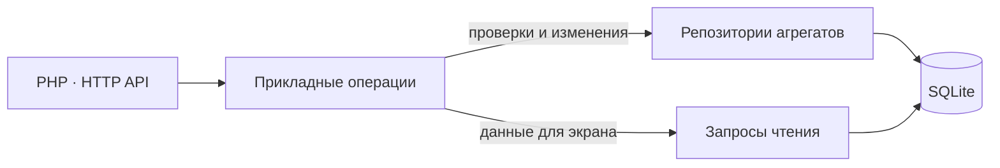

# Репозитории Project Desk

Проектное описание доступа к данным для [агрегатов Project Desk](../entity-vo/aggregates.md). Репозиторий загружает агрегат по идентификатору и сохраняет его изменения. Запрос чтения формирует данные под экран или ответ API. Прикладная операция связывает проверки доступа, правила предметной области и запись.

| Документ | Содержание |
|---|---|
| [Репозитории агрегатов](aggregate-repositories.md) | Операции, типы входов и результатов, соответствие SQLite |
| [Запросы чтения](read-queries.md) | Проекты, список задач, карточка и обзор «Требуют внимания» |
| [Транзакции и проверки](transactions.md) | Границы записи, конфликт версии и сценарии проверки |

Предлагаемая реализация использует конкретные PHP-классы с PDO и без фреймворка. Обозначения `TaskId`, `TaskVersion` и другие типы ниже выражают смысл контракта. В PHP их можно представить скалярами, enum или типизированными формами массивов. Интерфейс вводится при появлении нескольких реализаций или необходимости подменить зависимость. [Целевая архитектура](../../architecture/implementation.md).
